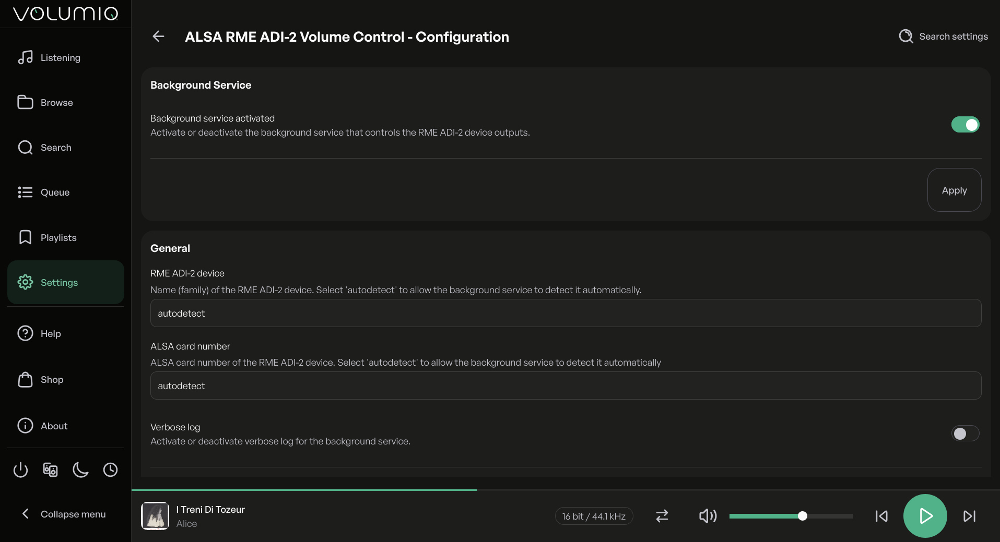
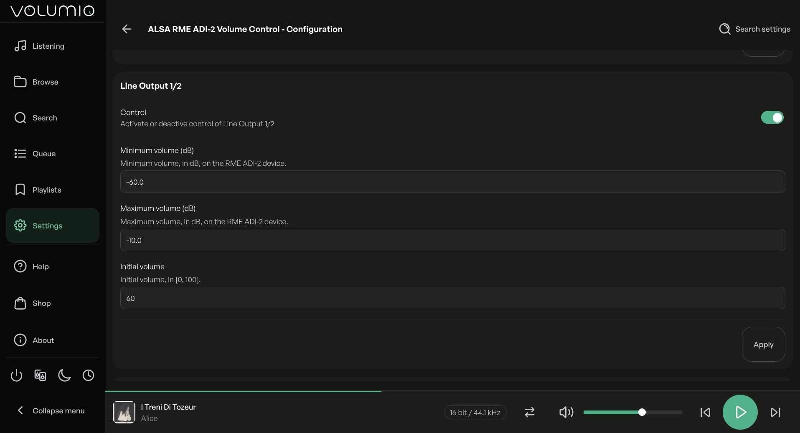
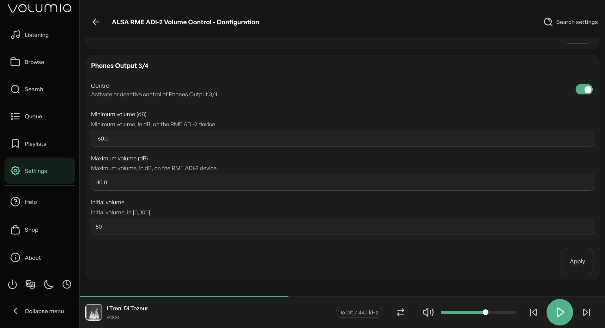

# ALSA RME ADI-2 Volume Control Plugin For Volumio

This Volumio plugin installs
the background service `alsa-rme-adi2-volume-control`
which provides an ALSA hardware mixer
for an attached RME ADI-2 device,
allowing the Volumio end user to change
the mute and volume state of the RME ADI-2 device
without any impact on the quality of the reproduced audio stream.


## Overview

By design,
[RME](https://rme-audio.de/home.html)
ADI-2 devices do not expose
[ALSA](https://www.alsa-project.org/)
hardware mixer controls,
the manufacturer preferring end users to change their mute and volume state
directly through the volume knob or the IR remote.
Fortunately, the RME ADI-2 devices also honor a MIDI protocol
that allows software using the MIDI interface
to get and set, among many other settings, their mute and volume state.

This
[Volumio plugin](https://developers.volumio.com/plugins/plugins-overview)
provides a simple way for Volumio end users
to install, start and control the background service
[`alsa-rme-adi2-volume-control`](https://github.com/pettarin/alsa-rme-adi2-volume-control)
which exposes an ALSA hardware mixer controlling
the mute and volume state of an RME ADI-2 device
attached to the Volumio host via USB, through its MIDI interface.
This ALSA hardware mixer can then be selected
in Volumio "Playback Options" as the hardware mixer that is linked to
the Volumio mute and volume controls (UI and API).

> [!TIP]
> A detailed explanation of how the background service works
> can be found in the last section of the
> [DEVELOPMENT](https://github.com/pettarin/alsa-rme-adi2-volume-control/blob/main/docs/DEVELOPMENT.md)
> document of the
> [`alsa-rme-adi2-volume-control`](https://github.com/pettarin/alsa-rme-adi2-volume-control)
> project.

### Supported RME ADI-2 Devices

The following families of RME ADI-2 devices are supported:

- [ADI-2 DAC](https://rme-audio.de/adi-2-dac.html) (device ID: `0x71`)
- [ADI-2 Pro](https://rme-audio.de/converter/adi-2-pro-ex.html) (device ID: `0x72`)
- [ADI-2/4 Pro](https://rme-audio.de/converter/adi-2-4-pro-ex.html) (device ID: `0x73`)

All device "variants" of each family should be supported
(e.g., `ADI-2 Pro AE`, `ADI-2 Pro FS`, `ADI-2 Pro FS BE`, and `ADI-2 Pro EX`
are all `ADI-2 Pro`),
since they share the same RME device ID
and the same MIDI interface for setting mute/volume parameters.

> [!WARNING]
> The author owns an RME ADI-2/4 Pro SE device, and the service
> has been extensively tested with it on different platforms.
> Given the design of the RME ADI-2 MIDI protocol,
> other RME ADI-2 devices should work out-of-the-box,
> but keep in mind that they have not been tested directly by the author.
>
> Refer to the
> [Tested Hardware/Software Configurations](https://github.com/pettarin/alsa-rme-adi2-volume-control/blob/main/docs/TESTED_CONFIGURATIONS.md)
> document for details.

### Limitations

In the current version of the service
(and hence in this Volumio plugin)
the synchronization of the state is one-way only:
from ALSA to the physical RME ADI-2 device.
If the user changes the mute or volume state on the RME ADI-2 device
(e.g., using the volume knob or the IR remote),
the ALSA controls will not be updated accordingly.

As a consequence, it is not possible to implement
a feature that reads the value of the mute and volume state
of the RME ADI-2 device, and sets the corresponding initial values
of the ALSA controls when the background service starts.

This is a known limitation which will be addressed in a future release.

### Translations

- [English](i18n/strings_en.json) by `pettarin`
- [Italian](i18n/strings_it.json) by `pettarin`

Feel free to open a PR to contribute a translation
for a language that is missing and that you are a (native) speaker of.


## Installation

On the UI of your Volumio host, go to the "Plugins" settings,
and in the "Available" tab search for "ALSA RME ADI-2 Volume Control"
under the "System Hardware" category of the plugin catalog,
and install it.
The installation typically takes less than one minute.


Once the plugin is installed, make sure your RME ADI-2 device
is connected and powered on, and then enable the plugin.


When the plugin is enabled the first time,
the `alsa-rme-adi2-volume-control` background service is started
with default parameters.

Navigate to the "Playback Options", and
make sure to have your RME ADI-2 device selected
as the "Output Device" in the "Audio Output" section.


Scroll down to the "Volume Options" section and
select "Hardware" as value of "Mixer Type", then hit the "Save" button.


A few seconds after you hit the "Save" button
the other hardware mixer controls should appear,
and you should be able to select
"Line Output 1/2" or "Phones Output 3/4"
as the "Mixer Control Name", depending on which output
of the RME ADI-2 device you want to control.


Congratulations!
You should be able to control the mute and volume state
of your RME ADI-2 device directly from the Volumio UI (or API):
notice how in the last screenshot the loudspeaker icon and the slider
to control the volume appeared in the bottom right corner.


## Plugin Settings

The Plugin Settings page for this plugin is divided into four sections.

### Background Service



This section contains only one control:

- Background service activated` (default: `true`).

The "Background service activated" switch
controls whether the background service
is running (`true`) or it is stopped (`false`).

This switch allows the user to stop or start the background service
without disabling/enabling or uninstalling/installing the whole plugin.

After changing the value of the switch
the button "Apply" must be clicked
for the change to take effect.

> [!TIP]
> Cycling the value of this control (`true` -> `false` -> `true`)
> is a way to achieve a manual restart of the background service.

### General


This section contains three controls:

- RME ADI-2 device (default: `autodetect`);
- ALSA card number (default: `autodetect`); and
- Verbose log (default: `false`).

The first two dropdown boxes "RME ADI-2 device" and "ALSA card number"
control the values of the options
`--device-name / --device-id` and `--card-number`
passed to the background service.

Users with only one RME ADI-2 device attached to the Volumio host
should be fine keeping the default value `autodetect` for both.

Users with multiple RME ADI-2 devices attached to the Volumio host
might want to specify the device name and ALSA card number
they want to connect to the Volumio mute and volume controls,
since it might not correspond to the RME ADI-2 device
that `autodetect` determines.
Indeed the autodetection process will use
the first (lowest ALSA card number) device that matches the device name.
If also the latter is `autodetect`, then the devices are probed
in this order: `ADI-2/4 Pro`, `ADI-2 Pro`, `ADI-2 DAC`.

> [!TIP]
> To learn the available ALSA cards (and their corresponding numbers),
> you can `ssh` into your Volumio host and issue the command
> `alsa-rme-adi2-volume-control --list-cards`.
>
> You should see an output similar to the following:
> ```bash
> alsa-rme-adi2-volume-control --list-cards
> Index  ID    Name
> 0      hw:0  vc4-hdmi-0
> 1      hw:1  vc4-hdmi-1
> 5      hw:5  ADI-2/4 Pro SE (52102163)
> ```
> which tells that an RME ADI-2/4 Pro SE is connected
> as ALSA card number `5`.

The "Verbose log" switch
controls the level of the log messages the background service emits:
`info` (`false`) or `debug` (`true`).
The messages can be inspected with `journalctl` or in the Volumio `/dev` page.

After changing the value of one or more of the controls in this section
the button "Apply" must be clicked
for the changes to take effect.
This will also cause a restart of the background service.

### Line Output 1/2 And Phones Output 3/4




These two sections contains the same four controls,
and they apply to the "Line Output 1/2" and "Phones Output 3/4"
outputs of the RME ADI-2 device, respectively:

- Control (default: `true`);
- Minimum volume (dB, default: `-60.0`);
- Maximum volume (dB, default: `-10.0`); and
- Initial volume (in `[0, 100]`, default: `50`).

The "Control" switch determines whether
the background service should control
the corresponding output of the RME ADI-2 device.
Its default value is `true` for both outputs,
resulting in both being controlled,
so that either can be selected as the "Mixer Control Name"
in the "Playback Options" by the Volumio end user.
Flipping one of these two switches prevents the background service
from registering the ALSA controls for the corresponding output.

> [!WARNING]
> You can disable the control of at most one output at a time.
> If you attempt to disable both at the same time,
> the last one you changed will not be disabled.
> This will be apparent when navigating away and then back
> to the plugin settings page.

The minimum and maximum volume levels (in dB) on the RME ADI-2 device
correspond to the logical ALSA values of `0` and `100`, respectively,
and they can be set to different values, independently for each output.

> [!WARNING]
> The allowed range of volume levels is `[-93.8, 6.0]` dB.
> Be careful when changing the minimum and maximum volume levels
> not to set them to values that are too large
> and dangerous for your hearing!

> [!WARNING]
> If you set a minimum volume level greater than or equal to
> the maximum volume level, the change will be rejected
> and the minimum volume level set to the lowest value possible
> (`-93.8` dB) to prevent the background service from failing.
> This will be apparent when navigating away and then back
> to the plugin settings page.

The initial (logical ALSA) volume is set on the output
when the background service starts (or restarts),
for example when the Volumio host boots up.
This ensures the RME ADI-2 device never plays
at a dangerous volume, outside the range controlled by
"Minimum volume (dB)" and "Maximum volume (dB)".
Each output can have a different initial volume value.

After changing the value of one or more of the controls in these sections
the button "Apply" must be clicked
for the changes to take effect.
This will also cause a restart of the background service.


## Support

To report a defect (bug) on the Volumio plugin itself,
please use the
[Issues of `volumio-plugins-sources-bookworm`](https://github.com/volumio/volumio-plugins-sources-bookworm/issues/)
and tag `pettarin` when creating the issue.

To get help, provide feedback, and for general discussions
about the Volumio plugin, please use the
[dedicated plugin discussion](https://community.volumio.com/t/plugin-alsa-rme-adi-2-volume-control/78093)
in the
[Volumio Community forum](https://community.volumio.com/).

To report a defect (bug) on the background service,
please use the
[Issues of `alsa-rme-adi2-volume-control`](https://github.com/pettarin/alsa-rme-adi2-volume-control/issues/).


### Live Log

Navigate to the `http://<your volumio host>/dev` page,
and enable the Volumio live log.

In a different browser tab,
go to the Plugins settings,
and disable and then re-enable the plugin.

In the live log text area you should see messages like the following ones:

```
info: Stopping and disabling service ...
info: Stopping and disabling service ... done
info: Disabling plugin alsa_rme_adi2_volume_control
info: Done.
 volumio : PWD=/ ; USER=root ; COMMAND=/bin/systemctl stop alsa-rme-adi2-volume-control.service
pam_unix(sudo:session): session opened for user root(uid=0) by (uid=1000)
[INFO] Control loop exited with return code '0'
Stopping alsa-rme-adi2-volume-control.service - Service exposing ALSA mute/volume controls on an RME ADI-2 device via MIDI...
alsa-rme-adi2-volume-control.service: Deactivated successfully.
Stopped alsa-rme-adi2-volume-control.service - Service exposing ALSA mute/volume controls on an RME ADI-2 device via MIDI.
pam_unix(sudo:session): session closed for user root
info: ALSA RME ADI-2 Volume Control: service stopped
 volumio : PWD=/ ; USER=root ; COMMAND=/bin/systemctl disable alsa-rme-adi2-volume-control.service
pam_unix(sudo:session): session opened for user root(uid=0) by (uid=1000)
Reloading.
/lib/systemd/system/sshtunnel.service:6: Standard output type syslog is obsolete, automatically updating to journal. Please update your unit file, and consider removing the setting altogether.
/lib/systemd/system/sshtunnel.service:7: Standard output type syslog is obsolete, automatically updating to journal. Please update your unit file, and consider removing the setting altogether.
pam_unix(sudo:session): session closed for user root
info: ALSA RME ADI-2 Volume Control: service disabled
info: Enabling plugin alsa_rme_adi2_volume_control
info: Loading plugin "alsa_rme_adi2_volume_control"...
info: Applying required configuration parameters for plugin alsa_rme_adi2_volume_control
info: PLUGIN START: alsa_rme_adi2_volume_control
info: Configuration
info:   card_number:     autodetect
info:   device_name:     autodetect
info:   line12_active:   true
info:   line12_max_db:   -10.0
info:   line12_min_db:   -60.0
info:   line12_volume:   60
info:   phones34_active: true
info:   phones34_max_db: -10.0
info:   phones34_min_db: -60.0
info:   phones34_volume: 50
info:   service_active:  true
info:   verbose_log:     false
info: Enabling and starting service ...
info: Enabling and starting service ... done
info: Done.
 volumio : PWD=/ ; USER=root ; COMMAND=/bin/systemctl enable alsa-rme-adi2-volume-control.service
pam_unix(sudo:session): session opened for user root(uid=0) by (uid=1000)
Reloading.
/lib/systemd/system/sshtunnel.service:6: Standard output type syslog is obsolete, automatically updating to journal. Please update your unit file, and consider removing the setting altogether.
/lib/systemd/system/sshtunnel.service:7: Standard output type syslog is obsolete, automatically updating to journal. Please update your unit file, and consider removing the setting altogether.
pam_unix(sudo:session): session closed for user root
info: ALSA RME ADI-2 Volume Control: service enabled
 volumio : PWD=/ ; USER=root ; COMMAND=/bin/systemctl start alsa-rme-adi2-volume-control.service
pam_unix(sudo:session): session opened for user root(uid=0) by (uid=1000)
Started alsa-rme-adi2-volume-control.service - Service exposing ALSA mute/volume controls on an RME ADI-2 device via MIDI.
pam_unix(sudo:session): session closed for user root
info: ALSA RME ADI-2 Volume Control: service started
[INFO] Using device ID '0x73'
[INFO] Using ALSA card '5'
[INFO] Using MIDI device 'hw:5,0,0'
[INFO] Start control loop for device ID '0x73' on MIDI device 'hw:5,0,0' of ALSA card number '5'
[INFO] SET mute off on line12
[INFO] SET volume 60 == -30.0 dB on line12
[INFO] SET mute off on phones34
[INFO] SET volume 50 == -35.0 dB on phones34
[INFO] Monitoring ALSA user-defined control elements 'Line Output 1/2 Playback Volume' and 'Line Output 1/2 Playback Switch' for changes
[INFO] Monitoring ALSA user-defined control elements 'Phones Output 3/4 Playback Volume' and 'Phones Output 3/4 Playback Switch' for changes
```

Every time you change the mute or volume state of Volumio,
you should see the corresponding `SET` messages in the live log.

If you have the verbose log enabled
(see the "Plugin Settings" section above),
you will see the actual ALSA events captured and
the MIDI commands sent to the RME ADI-2 device:

```
# mute Line Output 1/2
[DEBU] Read integer value 60
[DEBU] Read boolean value 0
[DEBU] WRITE MIDI SysEx: F0 00 20 0D 73 02 1B 60 01 F7 (mute: on, output: line12)
[INFO] SET mute on on line12

# unmute Line Output 1/2 and restore its volume 60%
[DEBU] Read integer value 60
[DEBU] Read boolean value 1
[DEBU] WRITE MIDI SysEx: F0 00 20 0D 73 02 1B 60 00 F7 (mute: off, output: line12)
[INFO] SET mute off on line12
[DEBU] WRITE MIDI SysEx: F0 00 20 0D 73 02 1B 1D 54 F7 (volume: -30.0 dB, output: line12)
[INFO] SET volume 60 == -30.0 dB on line12

# set volume 40% for Line Output 1/2
[DEBU] Read integer value 40
[DEBU] Read boolean value 1
[DEBU] WRITE MIDI SysEx: F0 00 20 0D 73 02 1B 60 00 F7 (mute: off, output: line12)
[INFO] SET mute off on line12
[DEBU] WRITE MIDI SysEx: F0 00 20 0D 73 02 1B 1C 70 F7 (volume: -40.0 dB, output: line12)
[INFO] SET volume 40 == -40.0 dB on line12
```

> [!TIP]
> It is normal to see a "SET mute off" message
> before each "SET volume" message.


## Releases And Changelog

The list of releases and their changes is contained
in the
[CHANGELOG](docs/CHANGELOG.md)
document.


## Plugin Contents

```
volumio-plugins-sources-bookworm/alsa_rme_adi2_volume_control
├── check_uninstall_was_clean.sh                        <- helper script for the developer to check that uninstall.sh left no relics
├── config.json                                         <- default configuration of the plugin
├── docs                                                <- documentation
│   ├── CHANGELOG.md                                    <- changelog of the plugin
│   └── ROADMAP.md                                      <- roadmap of the development of the plugin
├── i18n                                                <- translation files
...
├── imgs                                                <- images (screenshots) for this README
...
├── index.js                                            <- plugin logic to configure/start/stop the background service
├── install.sh                                          <- install script
├── LICENSE                                             <- full text of the license
├── package.json                                        <- plugin manifest
├── package-lock.json
├── README.md                                           <- this README file
├── requiredConf.json
├── service                                             <- background service
│   ├── bin
│   │   ├── amd64
│   │   │   └── alsa-rme-adi2-volume-control            <- amd64 (x86_64 64-bit) executable
│   │   ├── armhf
│   │   │   └── alsa-rme-adi2-volume-control            <- armhf (ARM 32-bit) executable
│   │   └── README.md                                   <- README tracking the provenance of the executable binaries
│   ├── sudoers
│   │   └── alsa-rme-adi2-volume-control                <- sudoers file (used during installation)
│   ├── systemd
│   │   ├── 99-alsa-rme-adi2-volume-control.preset      <- preset file for the systemd service
│   │   └── alsa-rme-adi2-volume-control.service        <- systemd service unit (definition) file
│   └── udev
│       └── 99-alsa-rme-adi2-volume-control.rules       <- udev rules for RME ADI-2 devices
├── UIConfig.json                                       <- plugin settings UI
├── uninstall.sh                                        <- uninstall script
└── VERSION                                             <- version of this plugin
```


## License

This project is licensed under
the GNU General Public License v3.0 (GPLv3).

See the
[LICENSE](LICENSE)
file for details.


## Authors

- Alberto Pettarin ([Web](https://www.albertopettarin.it))


## Legal Disclaimers

RME is a registered trademark of RME Intelligent Audio Solutions,
a company registered in Germany (VAT ID: DE813455918).

Please refer to the
[RME Imprint](https://rme-audio.de/imprint.html).

This project and its authors are not affiliated
nor endorsed by RME.

Volumio and the Volumio logo are registered trademarks of Volumio SRL,
a company registered in Italy (VAT ID: IT07009020483).

Please refer to the
[Volumio Terms Of Service](https://volumio.com/terms-of-service/).

This project and its authors are not affiliated
nor endorsed by Volumio SRL.

