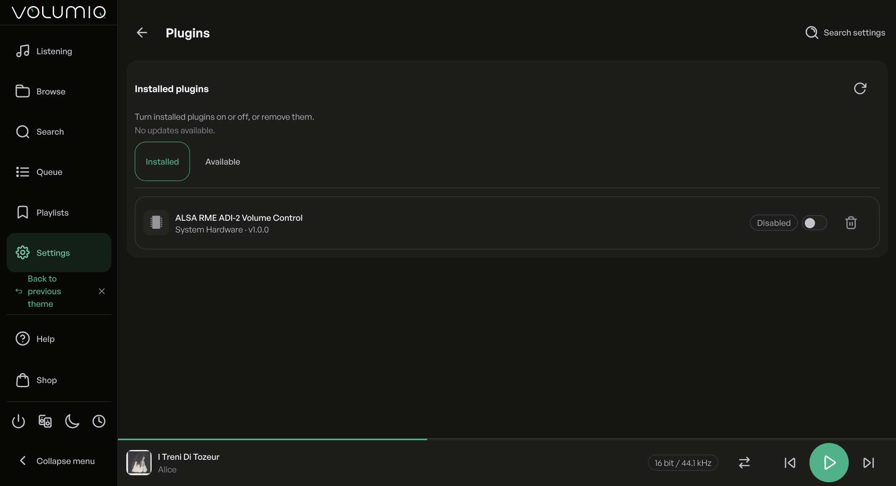
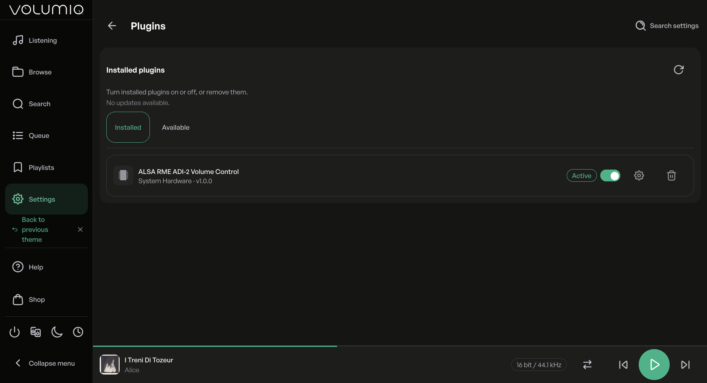
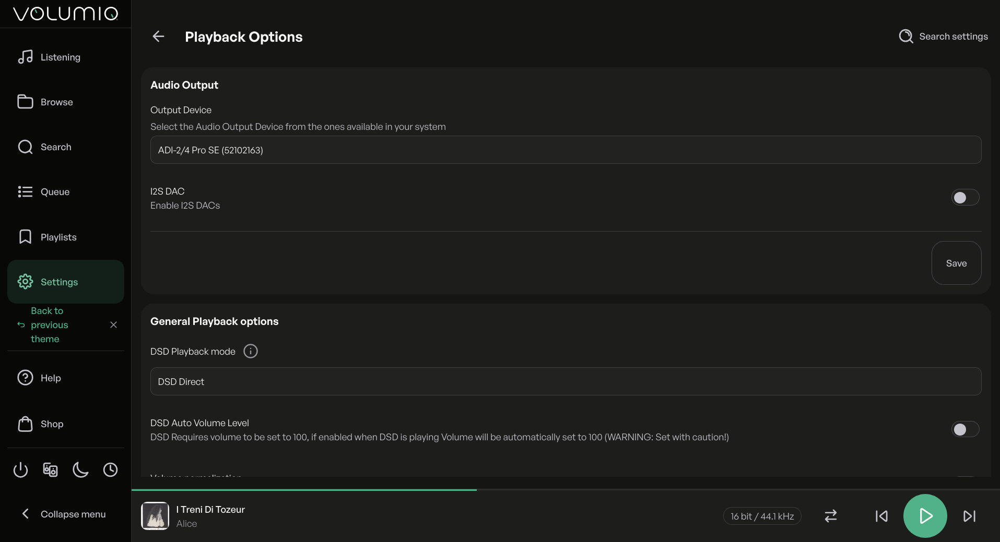
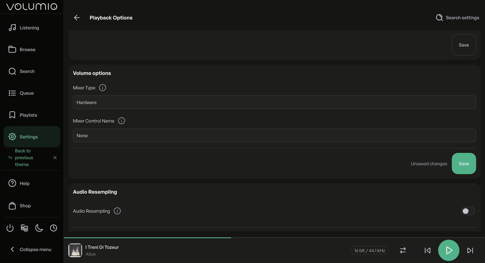
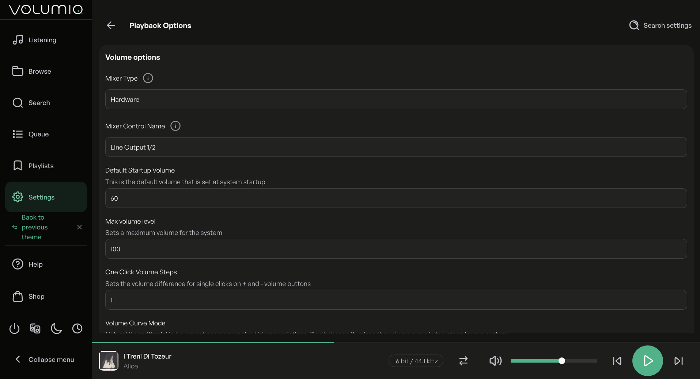

# ALSA RME ADI-2 Volume Control Plugin For Volumio

This Volumio plugin installs
the background service `alsa-rme-adi2-volume-control`
which provides a fake ALSA hardware mixer
for an attached RME ADI-2 device,
allowing the Volumio end user to change
the mute and volume state of the RME ADI-2 device
without any impact on the quality of the reproduced audio stream.


## Overview

By design,
[RME](https://rme-audio.de/home.html)
ADI-2 devices do not expose
[ALSA](https://www.alsa-project.org/)
hardware mixer controls,
the manifacturer preferring end users to change their mute and volume state
directly through the volume knob or the IR remote.
Fortunately, the RME ADI-2 devices also honor a MIDI protocol
that allows software using the MIDI interface
to get and set their mute and volume state (and many other settings).

This Volumio plugin provides a simple way for Volumio end users
to install, start and control the background service
[alsa-rme-adi2-volume-control](https://github.com/pettarin/alsa-rme-adi2-volume-control)
which exposes a fake ALSA hardware mixer controlling
the mute and volume state of an RME ADI-2 device
attached to the Volumio host via USB, through its MIDI interface.
This fake ALSA hardware mixer can then be selected
in Volumio "Playback Options" as the hardware mixer that is linked to
the Volumio mute and volume controls (UI and API).

> [!TIP]
> A detailed explanation of how the background service works
> can be found in the last section of the
> [DEVELOPMENT](https://github.com/pettarin/alsa-rme-adi2-volume-control/blob/main/docs/DEVELOPMENT.md)
> document of the `alsa-rme-adi2-volume-control` project.

### Supported RME ADI-2 Devices

The following families of RME ADI-2 devices are supported:

- [ADI-2 DAC](https://rme-audio.de/adi-2-dac.html) (device ID: `0x71`)
- [ADI-2 Pro](https://rme-audio.de/converter/adi-2-pro-ex.html) (device ID: `0x72`)
- [ADI-2/4 Pro](https://rme-audio.de/converter/adi-2-4-pro-ex.html) (device ID: `0x73`)

All device "variants" of each family should be supported
(e.g., `ADI-2 Pro AE`, `ADI-2 Pro FS`, `ADI-2 Pro FS BE`, and `ADI-2 Pro EX`
are all `ADI-2 Pro`),
since they share the same RME device ID
and the same MIDI interface for setting mute/volume parameters.

> [!WARNING]
> The author owns an RME ADI-2/4 Pro SE device, and the service
> has been extensively tested with it on different platforms.
> Given the design of the RME ADI-2 MIDI protocol,
> other RME ADI-2 devices should work out-of-the-box,
> but keep in mind that they have not been tested directly by the author.
>
> Refer to the
> [Tested Hardware/Software Configurations](https://github.com/pettarin/alsa-rme-adi2-volume-control/blob/main/docs/TESTED_CONFIGURATIONS.md)
> document for details.

### Limitations

In the current version of the service (and hence in this Volumio plugin)
the synchronization of the state is one-way only:
from ALSA to the physical RME ADI-2 device.
If the user changes the mute or volume state on the RME ADI-2 device
(e.g., using the volume knob or the IR remote),
the ALSA controls will not be updated accordingly.

This is a known limitation which will be addressed in a future release.

### Translations

- [English](i18n/strings_en.json)
- [Italian](i18n/strings_it.json)

Feel free to open a PR to contribute a translation
for a language that is missing and that you are a (native) speaker of.
(Do not just use an automated tool!)


## Installation

On the UI of your Volumio host, go to "Plugins",
search for "ALSA RME ADI-2 Volume Control" in the plugin catalog,
and install it.
The installation typically takes less than one minute.



Once the plugin is installed, make sure your RME ADI-2 device
is connected and powered on, and then enable the plugin.



When the plugin is enabled the first time,
the `alsa-rme-adi2-volume-control` background service is started
with default parameters.

Navigate to the "Playback Options", and
make sure to have your RME ADI-2 device selected
as the "Output Device" in the "Audio Output" section.



Scroll down to the "Volume Options" and
select "Hardware" as value of "Mixer Type", then hit the "Save" button.



The other hardware mixer controls should appear,
and you should be able to select
"Line Output 1/2" or "Phones Output 3/4"
as the "Mixer Control Name", depending on which output
of the RME ADI-2 device you want to control.



You should be able to control the mute and volume state
of your RME ADI-2 device directly from the Volumio UI or API.

> [!TIP]
> By default, they are both `autodetect`, which will result
> in the first (lowest ALSA card number) one to be used.
>
> If you have more than one RME ADI-2 device attached,
> you might want to specify in the plugins settings (see below)
> the RME Device and ALSA Card Number of the device you want to use.
> (See the next section "Plugin Settings".)

> [!TIP]
> Rebooting the Volumio host is not necessary,
> but it might help in case of problems with the background service
> controlling the RME ADI-2 device.


## Plugin Settings

TODO


## Support

- [Dedicated discussion on Volumio Community](https://community.volumio.com/t/plugin-alsa-rme-adi-2-volume-control/78093)
- [Issues of volumio-plugins-sources-bookworm](https://github.com/volumio/volumio-plugins-sources-bookworm/issues/)
- [Issues of alsa-rme-adi2-volume-control](https://github.com/pettarin/alsa-rme-adi2-volume-control/issues/)


## Releases And Changelog

The list of releases and their changes is contained
in the
[CHANGELOG](docs/CHANGELOG.md)
document.


## Plugin Contents

```
volumio-plugins-sources-bookworm/alsa_rme_adi2_volume_control
├── check_uninstall_was_clean.sh                        <- helper script for the developer to check that uninstall.sh left no relics
├── config.json                                         <- default configuration of the plugin
├── docs                                                <- documentation
│   ├── CHANGELOG.md                                    <- changelog of the plugin
│   └── ROADMAP.md                                      <- roadmap of the development of the plugin
├── i18n                                                <- translation files
...
├── imgs                                                <- images (screenshots) for this README
...
├── index.js                                            <- plugin logic to configure/start/stop the background service
├── install.sh                                          <- install script
├── LICENSE                                             <- full text of the license
├── package.json                                        <- plugin manifest
├── package-lock.json
├── README.md                                           <- this README file
├── requiredConf.json
├── service                                             <- background service
│   ├── bin
│   │   ├── amd64
│   │   │   └── alsa-rme-adi2-volume-control            <- amd64 (x86_64 64-bit) executable
│   │   ├── armhf
│   │   │   └── alsa-rme-adi2-volume-control            <- armhf (ARM 32-bit) executable
│   │   └── README.md                                   <- README tracking the provenance of the executable binaries
│   ├── sudoers
│   │   └── alsa-rme-adi2-volume-control                <- sudoers file (used during installation)
│   ├── systemd
│   │   ├── 99-alsa-rme-adi2-volume-control.preset      <- preset file for the systemd service
│   │   └── alsa-rme-adi2-volume-control.service        <- systemd service unit (definition) file
│   └── udev
│       └── 99-alsa-rme-adi2-volume-control.rules       <- udev rules for RME ADI-2 devices
├── UIConfig.json                                       <- plugin settings UI
├── uninstall.sh                                        <- uninstall script
└── VERSION                                             <- version of this plugin
```


## License

This project is licensed under
the GNU General Public License v3.0 (GPLv3).

See the
[LICENSE](LICENSE)
file for details.


## Authors

- Alberto Pettarin ([Web](https://www.albertopettarin.it))


## Legal Disclaimers

RME is a registered trademark of RME Intelligent Audio Solutions,
a company registered in Germany (VAT ID: DE813455918).

Please refer to the
[RME Imprint](https://rme-audio.de/imprint.html).

This project and its authors are not affiliated
nor endorsed by RME.

