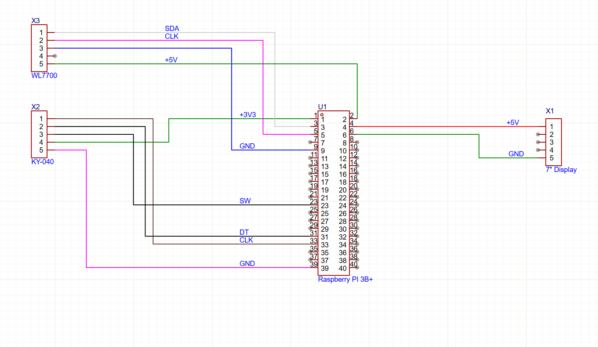
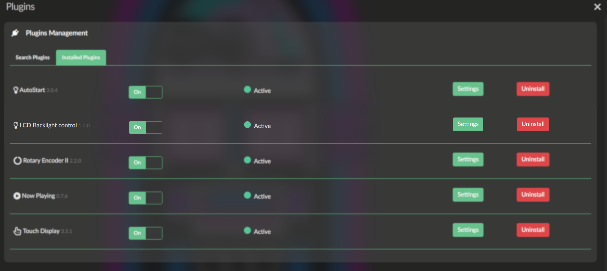
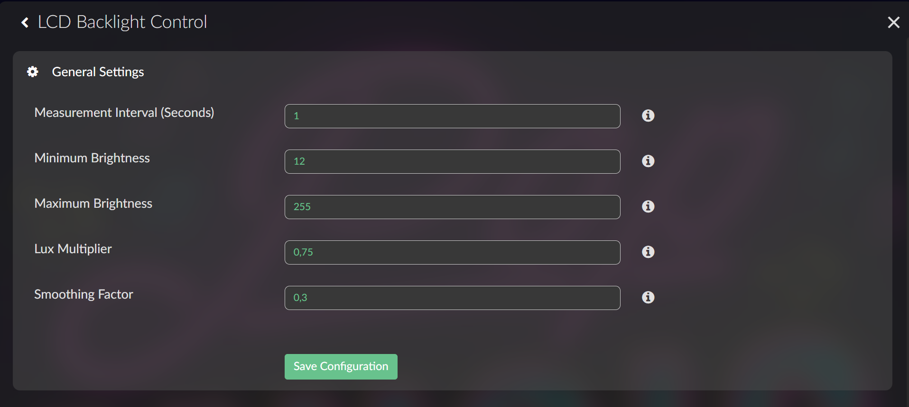

#    LCD Backlight Control Plugin for Volumio 3 and Volumio 4


%20%7C%204%20(bookworm)-orange.svg)


A Volumio 3 (buster) and Volumio 4 (bookworm) plugin for automatic LCD backlight control based on ambient light levels using the VEML7700 light sensor, with intelligent brightness boost during music playback.

**Tested on**: Volumio 3.832 (Volumio 3, buster) and Volumio 4.239 (Volumio 4, bookworm).

## Overview

This plugin automatically adjusts the brightness of LCD displays with backlight control based on ambient light conditions. It uses the VEML7700 ambient light sensor to measure lux levels and dynamically adjusts the display brightness for optimal viewing in any lighting environment. Additionally, it can increase brightness during music playback for better visibility.

## Features

- **Automatic Brightness Control**: Adjusts LCD backlight based on ambient light readings from VEML7700 sensor
- **Playback-Aware Brightness Boost**: Automatically increases brightness during music playback and maintains it for a configurable duration after playback stops
- **Configurable Brightness Range**: Set minimum and maximum brightness levels to suit your preferences
- **Smooth Transitions**: Adjustable smoothing factor for gradual brightness changes
- **Customizable Sensor Calibration**: Fine-tune the sensor response with a lux multiplier
- **Flexible Measurement Interval**: Configure how often the sensor reads ambient light (0.1 - 10 seconds)
- **Real-time Playback Detection**: Receives Volumio playback state changes directly, without polling the API
- **Live Configuration**: Changed settings are applied immediately, without restarting the service
- **Full Brightness When Disabled**: The display is set to full brightness when the plugin is disabled or uninstalled
- **Multi-language Support**: Translations for all Volumio-supported languages

## 🔧 Hardware Components

| Component | Model/Type | Description |
|-----------|------------|-------------|
| **Main Unit** | Raspberry Pi 3B+ | Control unit |
| **Display** | 7" LCD DPI (OFI009) | Touch display connected via DPI interface |
| **Encoder** | KY-040 | Rotary encoder for volume control |
| **Light Sensor** | VEML7700 (BH-014PA) | 16-bit I²C ambient light sensor |

## 🔌 Wiring Diagram

### I²C Bus (VEML7700 Sensor)



| Raspberry Pi 3B+   |     VEML7700 (WL7700) |
|--------------------|----------------------|
| Pin 1  (3.3V)    |  Pin 5 (+3.3V) |
| Pin 3  (GPIO 2)  |  Pin 2 (SDA) |
| Pin 5  (GPIO 3)  |  Pin 1 (SCL) |
| Pin 6  (GND)     |  Pin 4 (GND) |


### GPIO Pinout Reference PI3B

|Pin| BCM | wPi | Name   | Mode | V |
|----|----|-----|--------|------|---|
| 1  |    |     | 3.3V   |      |   |
| 2  |    |     | 5V     |      |   |
| 3  | 2  | 8 | SDA.1  | ALT0 | 1 |
| 4  |    |     | 5V     |     |   |
| 5  | 3  | 9 | SCL.1  | ALT0 | 1 |
| 6  |    |   | GND    |  |   |
| 7  | 4  | 7 | GPIO. 7 | IN   | 1 |
| 8  | 14 | 15 | TxD    | IN   | 0 |

### Rotary Encoder (KY-040)

- **CLK**: GPIO pin (BCM numbering from `gpio readall`)
- **DT**: GPIO pin (BCM numbering)
- **SW**: GPIO pin (button)
- **+**: 3.3V
- **GND**: Ground

> **Note**: Configure encoder pins in Volumio's Rotary Encoder plugin using **BCM** pin numbers.<br>
>           **No KY-040 rotary encoder connection is needed for the plugin to function properly.**

### Display Connection

- **Power**: +5V and GND from connector X1
- **DPI Signals**: Connected according to `/boot/config.txt` DPI configuration


## Installation

I²C must be enabled (e.g. `dtparam=i2c_arm=on` in `/boot/userconfig.txt`) and the sensor must be visible with `sudo i2cdetect -y 1` at address `0x10`.

1. Install the plugin through the Volumio web interface:
   - Navigate to **Plugins** → **Search Plugins**
   - Search for "LCD Backlight control" and install it
   - Enable the plugin in **Plugins** → **Installed Plugins**

2. Manual installation (from the source code), run on the Volumio device:
   ```
   git clone https://github.com/lubomirkarlik/volumio-plugins-sources-bookworm.git --depth=1 -b lcd_backlight
   cd volumio-plugins-sources-bookworm/lcd_backlight
   volumio plugin install
   ```
   - The plugin will appear among the installed plugins.
   - The same source code works on Volumio 3 (buster, Node 14, Python 3.7) and Volumio 4 (bookworm, Node 20, Python 3.11).
   - Tested on Volumio 3.832 and Volumio 4.239.



The installation script will:
   - Install the Python dependency (`python3-smbus`), only if it is not installed yet
   - Link the Python control script to `/usr/local/bin/`
   - Create configuration directory at `/etc/lcd_backlight/`
   - Install the systemd service (it is started and stopped by the plugin, not at boot)
   - Set appropriate permissions

## Configuration

Access the plugin settings through the Volumio web interface under **Plugins** → **Installed Plugins** → **LCD Backlight control** → **Settings**.


### Available Settings

#### Measurement Interval
- **Range**: 0.1 - 10 seconds
- **Default**: 1 second
- **Description**: Time between light sensor readings. Lower values provide more responsive brightness changes but may increase CPU usage.

#### Minimum Brightness
- **Range**: 0 - 255
- **Default**: 12
- **Description**: The lowest brightness level the display will reach. Prevents the screen from becoming too dark or turning off completely. Must not be greater than Maximum Brightness.

#### Maximum Brightness
- **Range**: 0 - 255 (limited to `max_brightness` of the backlight device)
- **Default**: 255
- **Description**: The highest brightness level the display will reach. Can be reduced to save power or limit maximum brightness.

#### Lux Multiplier
- **Range**: 0.01 - 10
- **Default**: 0.75
- **Description**: Calibration multiplier for the VEML7700 sensor. Increase for brighter response to ambient light, decrease for darker response. Use this to fine-tune the sensor's sensitivity to your environment.

#### Smoothing Factor
- **Range**: 0.05 - 1.0
- **Default**: 0.3
- **Description**: Controls how quickly brightness transitions occur. Lower values create slower, smoother transitions. Higher values make brightness changes more immediate and responsive.

#### Playback Brightness Boost
- **Range**: 0 - 255
- **Default**: 0
- **Description**: Additional brightness added to the calculated brightness level during music playback. This ensures better screen visibility when actively using the player. Set to 0 to disable this feature.

#### Boost Duration After Playback
- **Range**: 0 - 300 seconds
- **Default**: 30 seconds
- **Description**: How long to maintain the brightness boost after playback stops. This provides a grace period before the brightness returns to ambient-based levels. Useful to keep the screen bright while browsing between tracks.

## How It Works

### Ambient Light Control
1. The plugin reads ambient light levels from the VEML7700 sensor at regular intervals
2. The raw reading is multiplied by the configured lux multiplier for calibration
3. The brightness value is calculated using a logarithmic curve and constrained within the min/max range
4. If the sensor cannot be read, the current brightness is kept

### Playback Boost System
1. The plugin receives every Volumio state change (`volumioPushState`) and writes the playback state to `/etc/lcd_backlight/lcd_playing` (`1` = playing). The file is written only when playback starts or stops; the Volumio API is not polled.
2. When playback status changes to "play":
   - The configured brightness boost is added to the ambient-calculated brightness
   - The boost remains active throughout playback
3. When playback stops:
   - A countdown timer starts for the configured boost duration
   - The boost remains active during this period
   - After the timer expires, brightness returns to ambient-only control
4. A smoothing algorithm gradually adjusts the backlight to prevent abrupt changes

### Final Brightness Calculation
```
Final Brightness = min(MAX_BACKLIGHT, Ambient_Brightness + Playback_Boost)
```

## Technical Details

### File Structure
```text
lcd_backlight/
   ├── index.js              # Main plugin controller
   ├── backlight_control.py  # Python script for hardware control
   ├── lcd_backlight.service # Systemd service file
   ├── install.sh            # Installation script
   ├── uninstall.sh          # Uninstallation script
   ├── UIConfig.json         # Web UI configuration
   ├── config.json           # Default plugin settings
   ├── package.json          # Plugin metadata
   ├── i18n/                 # Translations
   │     ├── strings_en.json # English strings
   │     ├── strings_sk.json # Slovak strings
   │     └── strings_...json # Other language strings DE, FR, ...
   └── images/               # Images
         ├── logo.png             # Logo image
         ├── plugin_settings.png  # Settings image
         ├── veml7700_schema.png  # Schematics drawings
         └── volumio_plugins.png  # Plugins screenshot

/usr/local/bin/
   └── backlight_control.py  # Symlink to the Python script in the plugin folder
```

### Configuration Files

The plugin stores configuration in two locations:

1. **Persistent Config**: `/data/configuration/system_hardware/lcd_backlight/config.json`
   - Stores all plugin settings
   - Managed by Volumio's configuration system

2. **Runtime Config**: `/etc/lcd_backlight/`
   - Individual files for each setting (e.g., `lcd_enabled`, `lcd_int_time`, `lcd_playback_boost`)
   - Written by the plugin, read by the Python control script
   - Changes are detected and applied without restarting the service

### Service Management

The plugin uses a systemd service (`lcd_backlight.service`) that:
- Runs the Python control script as a daemon
- Is started when the plugin is enabled and stopped when it is disabled
- Sets the display to full brightness when stopped
- Restarts automatically on failure (e.g. sensor not ready yet)
- Logs to systemd journal
- Reads the playback state written by the plugin

#### Log Output Example

For debug purpose, uncomment the two lines at the end of `_update_brightness()` in `backlight_control.py`:
```python
# Uncomment for debugging:
# boost_indicator = " [BOOST]" if self.playback_boost_active and self.playback_boost > 0 else ""
# log(f"Lux: {lux:8.1f} | Brightness: {brightness:3d}/{self.max_backlight}{boost_indicator}")
```

Output in `journalctl -u lcd_backlight.service -f` will be:
```
[12:34:56] Lux:    245.3 | Brightness: 145/255
[12:34:57] Lux:    248.1 | Brightness: 147/255
[12:35:12] Playback STARTED - activating boost (+50)
[12:35:13] Lux:    251.7 | Brightness: 199/255 [BOOST]
[12:37:45] Playback STOPPED - boost active for 30s
[12:38:15] Boost period EXPIRED - deactivating
[12:38:16] Lux:    249.2 | Brightness: 148/255
```

### Playback State Integration

The plugin registers a `volumioPushState` callback in Volumio. On every state change it checks
`state.status` (`play`, `pause`, `stop`) and, only when playing/not playing changes, writes
`1` or `0` to `/etc/lcd_backlight/lcd_playing`. The Python service reads this file in every
measurement cycle. No HTTP requests are made, so the Volumio log is not filled with
`CoreCommandRouter::volumioGetState` messages.

## Troubleshooting

### Plugin is not shown in Installed Plugins
- Do not run `install.sh` manually. It only installs system files, the plugin is registered in Volumio by `volumio plugin install`.
- Run `volumio plugin install` as user `volumio` (not as root and not with `sudo`). `whoami` must print `volumio`.

### Installation hangs at "Downloading plugin"
If the Volumio log (`sudo journalctl -f`) shows
`/bin/mv: cannot move '/tmp/plugins/lcd_backlight.zip' to '/tmp/downloaded_plugin.zip': Permission denied`,
`volumio plugin install` was run as root before and left root-owned temporary files.
Volumio (user `volumio`) cannot move or overwrite them. Remove them once and install again as user `volumio`:
```
sudo rm -rf /tmp/plugins /tmp/downloaded_plugin.zip
cd /home/volumio/volumio-plugins-sources/lcd_backlight
volumio plugin install
```

### Old plugin behaviour after reinstall or update
Volumio keeps the previously loaded `index.js` in memory when a plugin is reinstalled
(Node.js module cache), only the Python service uses the new files. Restart Volumio after
every reinstall or update of the plugin:
```
volumio vrestart
```

### Plugin doesn't start
- Check if the VEML7700 sensor is properly connected via I²C
- Verify I²C is enabled on your system (`sudo i2cdetect -y 1`)
- Check systemd service status: `systemctl status lcd_backlight.service`
- Review logs: `journalctl -u lcd_backlight.service -f`

### Brightness not changing
- Verify the backlight device exists: `ls /sys/class/backlight/`
- Check configuration files in `/etc/lcd_backlight/`
- Ensure `lcd_enabled` is set to `1`
- Test sensor readings manually

### Playback boost not working
- Check if playback_boost is set to a value greater than 0
- During playback `cat /etc/lcd_backlight/lcd_playing` must print `1`
- Review service logs: `journalctl -u lcd_backlight.service -f` (shows "Playback STARTED")

### Brightness changes too quickly/slowly
- Adjust the **Smoothing Factor** setting
- Lower values = slower transitions
- Higher values = faster transitions

### Display too bright/dark
- Adjust the **Lux Multiplier** to calibrate sensor response
- Modify **Minimum Brightness** and **Maximum Brightness** ranges
- Fine-tune **Playback Brightness Boost** value
- Test in different lighting conditions

## Uninstallation

The plugin can be uninstalled through the Volumio web interface. The uninstallation process will:
- Stop the systemd service (the display is set to full brightness)
- Remove the service file and the Python script link
- Remove the runtime configuration directory `/etc/lcd_backlight`

## Version

**Current Version**: 1.2.0
 - Volumio 3 (buster) and Volumio 4 (bookworm) support from one source code, tested on Volumio 3.832 and Volumio 4.239
 - validation of settings (minimum must not exceed maximum)
 - settings are applied without restarting the service
 - full brightness restored when the plugin is disabled or uninstalled
 - service restarts automatically when the sensor is not ready at boot
 - service is no longer started at boot when the plugin is disabled
 - playback state is pushed by Volumio, the API is no longer polled every second

**1.1.0**
 - added boost brightness during playback
 - install/uninstall script fix


## License

This project is open-source and available under the ISC License. You may use and modify it freely. You may use the program as is at your own risk, no updates or modifications to the code will be made, no planned, and no warranties or claims for damages will be made in connection with any use of this code.

## Author

lubomirkarlik60@gmail.com

## Support

For issues, questions, or contributions, please visit the plugin's repository or contact through the e-mail.

---

**Note**: This plugin requires appropriate hardware (VEML7700 sensor and compatible LCD display) and may need system-level permissions to access I²C, and backlight control interfaces.
