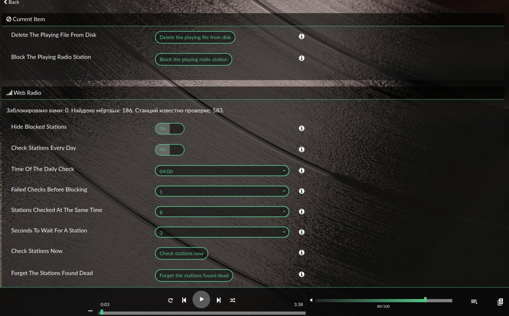

# Track Cleaner

A Volumio 4 (Bookworm) plugin for people who keep their web radio lists tidy.

## What it does

- **Block the playing station.** One button on the plugin settings page hides the station that is playing from every web radio list and from search, then moves on to the next item of the queue (or stops if there is none). Your own lists ("My Web Radios", "Favourites") are never filtered.
- **Find dead stations.** Once a day (or on demand) the plugin reads the radio screen itself: it opens the radio root and every folder on it once, remembers the stations found directly inside, then checks them. A station that fails several checks in a row is hidden; if it comes back to life it is shown again. If almost every station fails at once the plugin assumes your network is down and changes nothing.
- **Delete the playing file.** The first button deletes the music file that is playing, but only inside the folders you list in the settings (empty by default, so deleting is off until you choose a folder). Only audio files are ever deleted. The settings page lists the mounted music folders (`/mnt/...`, `/media/...`) as hints, but the roots are always typed manually.

## Where the settings are

Plugins > Installed > Track Cleaner > Settings.

## Screenshots



## Files

The plugin keeps its data in its own configuration folder: `blocklist.json` (readable and editable: `manual` and `dead` lists) and `state.json` (the registry of known stations and check results). It writes nothing under `/volumio`.

## How the station filter works

The plugin wraps three methods of the built-in web radio plugin in memory while it is running and removes the wrappers when it is stopped. No Volumio file is changed.

## Known limits

- The filter hides stations in the lists of the built-in web radio plugin; other radio plugins keep their own lists.
- Stations are collected automatically from the radio screen and its top level folders; nothing has to be opened by hand. Deeper categories (by genre, by country) are not walked.
- Deleting a file also removes it from playlists and favourites through Volumio's own functions; entries in other places may remain until Volumio notices that the file is gone.

## Requirements

- Volumio 4 (Debian 12 "Bookworm"), architectures `amd64` or `armhf`.
- The built-in **Web Radio** plugin (the station filter wraps its methods in memory; it is restored on stop).
- No system packages, no `sudo` rules and no extra network services.

## Installation

From the Volumio plugin store, or from a zip:

```bash
scp track_cleaner.zip volumio@volumio.local:/tmp/
ssh volumio@volumio.local
cd /tmp && unzip track_cleaner.zip && cd track_cleaner
volumio plugin install
```

Then open **Settings → Plugins → Installed plugins → Track Cleaner → Settings**.

## Uninstall

Disable and remove the plugin in the plugin manager. Files deleted by the user are not restored;
the plugin's own `blocklist.json` and `state.json` stay in its configuration folder.

## License

MIT (see `LICENSE`).

